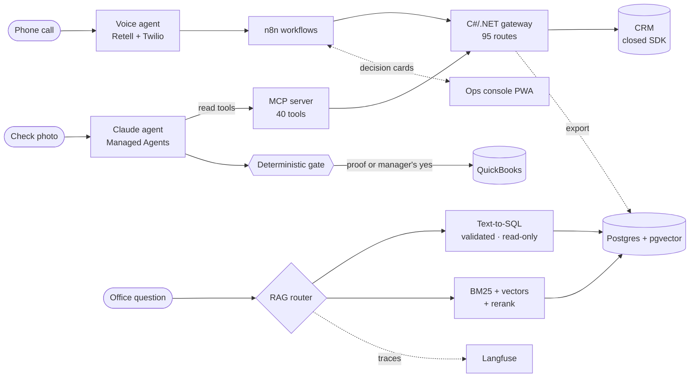

  

  
  
  

  

I build AI systems that do real work in a business and run them in production: a Claude agent that records customer payments, a RAG assistant over eight years of company data, a voice receptionist on a live phone line, and the integration layer that opens a closed CRM to all of them.

Every system is evaluated on real historical data before launch, and every write to a system of record passes a deterministic check and, where it matters, a human. I set the requirements, guardrails, evals and go/no-go calls and direct the design; Claude Code writes the code to my specs and tests.

## In production

| System | What it does | Measured |
|---|---|---|
| **Payments agent** Claude Managed Agents · 54 MCP tools | Matches check photos to the right job and invoice; a deterministic gate writes only on proof or a manager's "yes" | Blind backtest on 87 past payments: **77 correct, 9 escalated, 1 wrong** |
| **RAG over 8 years of CRM data** [emg-rag-public ↗](https://github.com/SanyaBoroda4/emg-rag-public) | Routed text-to-SQL (validated, read-only) + hybrid BM25/vector search with reranking; cited answers | **75 / 82** on a hand-verified golden set · recall@10 **0.28 → 0.82** · SQL p95 **1.96 s → 0.20 s** |
| **AI voice receptionist** Retell · Twilio · n8n | Recognizes callers from the CRM before the first word, qualifies leads, logs every call back to the CRM | Latency **1.7–2.3 s → ~1.4 s** median |
| **CRM gateway** [moraware-bridge ↗](https://github.com/SanyaBoroda4/moraware-bridge) | C#/.NET Web API over a closed vendor SDK with no public API | **95 routes · 230 tests** |
| **MCP server** [emg-mcp-portfolio ↗](https://github.com/SanyaBoroda4/emg-mcp-portfolio) | Gives Claude the CRM: dry-run writes, READ-ONLY reads, explicit "not readable" map | **40 tools** · tests in CI |
| **Ops console** [emg-console-portfolio ↗](https://github.com/SanyaBoroda4/emg-console-portfolio) | Mobile PWA where staff act on AI-read payments and slab scans through push decision cards | **105 tests** gate every deploy |
| **Thrift Agent** [thrift-agent ↗](https://github.com/SanyaBoroda4/thrift-agent) | Phone photos → live listings on Poshmark, Depop and Vinted; Opus groups, Sonnet extracts, Haiku checks | **~2,100 tests** · 3-OS CI |
| **Proof of Turnover** · Hackathon 2026 [proof-of-turnover ↗](https://github.com/SanyaBoroda4/proof-of-turnover) | Proves vacation-rental cleanings from the cleaner's photos and voice notes: an item counts as done only when two independent vision checks and SAM 3.1 agree on one photo; gaps become re-photo requests in her language | **186 tests** · Meta models only (Muse Spark, SAM 3.1, voice) |

## Architecture

## Engineering notes

<b>An agent that can't write without proof</b> · payments

 

The agent investigates each payment like a person would, through 54 tools, and proposes a match in plain language. It never writes directly: a deterministic gate re-checks the evidence in code and records the payment only on proof or a manager's explicit "yes". Before launch it was run blind against 87 historical payments (77 correct, 9 escalated to a human, 1 wrong), and the rollout was gated by 1,635 automated checks and 17 adversarial reviews.

<b>The slow query that wasn't where everyone looked</b> · RAG

 

Median SQL time was 0.03 s; p95 was 1.96 s. Per-call tracing showed every slow call hit one view. `EXPLAIN ANALYZE` named a correlated regex subquery running 3,399 times, not the `ILIKE` everyone suspected. A 184 kB partial index plus skipping a redundant re-count took p95 to 0.20 s, with output verified byte-identical by checksum.

<b>Why fusion alone made ranking worse</b> · retrieval

 

Each retrieval layer was measured against the same golden set. Reciprocal-rank fusion raised recall@10 from 0.28 (vectors alone) to 0.50, but MRR fell from 0.33 to 0.20: fusion finds more and orders it worse. Adding a reranker took recall@10 to 0.82 and MRR to 0.66. Measuring recall alone would have hidden the regression.

## How I work

- **Evals before launch.** Golden sets, blind historical backtests, a judge model that differs from the generator, known failures kept visible.
- **Deterministic gates on writes.** Models propose; code checks; people approve what matters.
- **Measure, don't assert.** Every number on this page comes from a command or a run file in the linked repo.
- **Spec-driven work with coding agents.** Written work orders with verification steps, scoped permissions and a required "what got worse" section.

## Stack

Open to AI Engineer · AI Solutions / Deployment Engineer roles — remote, or hybrid in Charleston, SC.

